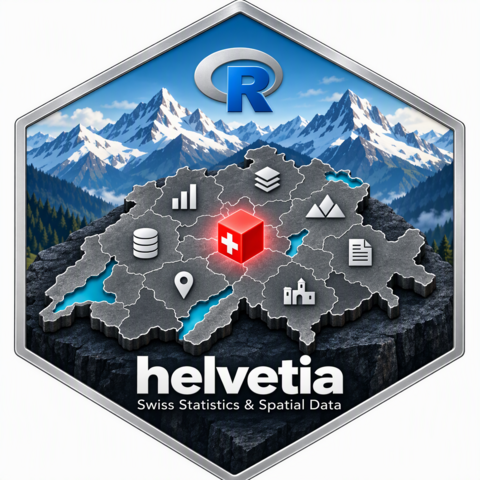

# 📦 helvetia 

<!-- badges: start -->
[](https://CRAN.R-project.org/package=helvetia)
[](https://www.gnu.org/licenses/old-licenses/gpl-2.0.html)
<!-- badges: end -->

**Title:** Consistent Access to Swiss Public Statistics, Regional Classifications and Spatial Data\
**License:** GPL (≥ 2)

## 🧩 Overview

`helvetia` gives you Swiss municipal registers, population, land use,
premium regions and map geometries from official sources (BFS,
swisstopo, BAG/priminfo) through one consistent interface.

Every result has an explicit time reference, carries its source metadata
and is cached locally, so analyses stay reproducible and work offline.
The package succeeds `bfsMaps`, whose map functions it has taken over.

📖 **Documentation:** <https://andrisignorell.github.io/helvetia/>

## ⚙️ Installation

``` r
install.packages("helvetia")
```

Or the development version from GitHub:

``` r
remotes::install_github("AndriSignorell/helvetia")
```

## 📚 Core Features

### 🔹 Registers

-   `gemeinde()`: municipalities valid on a date (AGVCH)
-   `gemeindeMutationen()`: mergers, splits, renames and renumberings
    between two dates
-   `raumgliederung()`: spatial classifications per municipality
-   `kanton()`: cantons with numbers, abbreviations and names

### 🔹 Statistics

-   `popGemeinde()`: STATPOP population by municipality, sex and age
-   `arealGemeinde()`, `noas()`: land use statistics (Arealstatistik)
    and the NOAS04 nomenclature
-   `praemienregion()`: premium regions of the mandatory health
    insurance

### 🔹 Geometries

-   `geoGemeinde()`, `geoBezirk()`, `geoKanton()`: boundaries from
    ThemaKart or swissBOUNDARIES3D
-   `geoThemakart()`, `themakartSets()`: any ThemaKart layer, by stand
-   `geoGewaesser()`: lakes and rivers

### 🔹 Maps and Spatial Tools

-   `plotMap()`, `addGewaesser()`, `stampBfs()`: thematic maps
-   `combineRegions()`, `neighbours()`: merging and neighbouring units
-   `locate()`, `geocode()`: assigning points and addresses to units

### 🔹 Sources and Cache

-   `sourceInfo()`: URL, download time, version and query of a result
-   `cacheList()`, `cacheClear()`: inspecting and clearing the local
    cache

## 🕰️ Time References

| Field | Meaning |
|---|---|
| `stand_d` | exact date of a register or geometry stand |
| `jahr_n` | statistical year (reference date of the counts) |
| `period_x` | multi-year survey period, e.g. `"2013/18"` |
| `gem_stand_d` | municipality stand a result is reported on |

The year of a statistic and the municipality stand it is reported on are
two different things. STATPOP counts for 2021, for instance, are
published on a later municipality stand (e.g. 6 April 2025). Always join
registers, statistics and geometries on the stand, never on the year
alone. An unchanged BFS number does not guarantee unchanged boundaries.

`geoGemeinde(date = stand)` returns the most recent geometry stand on or
before `stand` (ThemaKart stands are mostly 1 January), so it may be
earlier than the municipality stand of the statistic. Matching ids
(`setdiff()`) do not prove spatial compatibility: compare
`unique(geo$stand_d)` with `stand` and check the mutations in between with
`gemeindeMutationen(unique(geo$stand_d), stand)`.

## 🧪 Example

``` r
library(helvetia)

pop   <- popGemeinde(year = 2021)          # STATPOP, 31.12.2021
stand <- unique(pop$gem_stand_d)           # municipality stand of the cube
geo   <- geoGemeinde(date = stand)         # geometries of that stand

unique(geo$stand_d)                        # geometry stand actually used
setdiff(unique(pop$gem_id), geo$gem_id)    # ids only, not boundaries

popTotal <- aggregate(ch_n ~ gem_id, data = pop, FUN = sum)
plotMap(geo, id = popTotal$gem_id,
        col = hcl.colors(6, "Blues 3", rev = TRUE)[cut(log10(popTotal$ch_n), 6)],
        border = NA)
addGewaesser()

sourceInfo(pop)
```

Data are downloaded on first use and cached in
`tools::R_user_dir("helvetia", "cache")` (option `helvetia.cacheDir`).

## 🙏 Acknowledgements

The map union functions are based on code by Juerg Guggenbuehl from
`bfsMaps`. The data are provided by the Swiss Federal Statistical Office
(BFS), swisstopo and the Federal Office of Public Health (BAG); maps
based on ThemaKart must carry the source note added by `stampBfs()`.

Parts of the code and documentation were reviewed with the help of large
language models (OpenAI Codex, Anthropic Claude). Every suggestion was
assessed, edited and verified by the maintainer, who remains solely
responsible for the content of this package.

## 📜 License

GPL (≥ 2)
